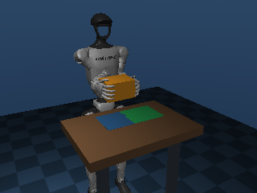
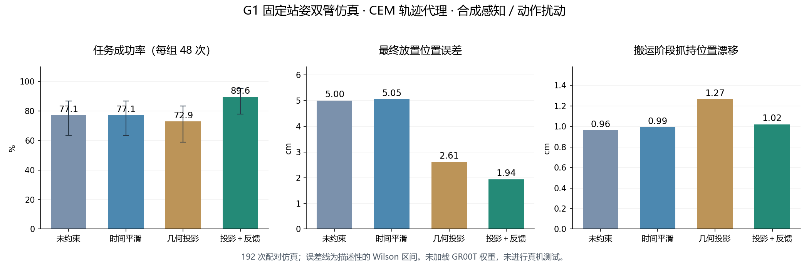

# Unitree G1 · 物体中心双臂接触搬运

基于 MuJoCo 的 G1 固定站姿双臂搬箱与目标放置仿真。包含 **14DoF 双臂、接触物理、SE(3) 双手协同投影、阶段门控、带延迟的物体位置反馈、192 次配对评估**，以及可运行的 30FPS 原生演示窗口。

默认归档评测的动作源为 **CEM 搜索得到的轨迹代理**，用于验证控制与执行层；归档结果没有加载 GR00T 权重，也没有真机数据或已训练 VLA checkpoint。

新增可选 [GR00T / SDK2 接口](docs/deployment-interfaces.md)：本地/远程 GR00T、自定义模态校验、模型动作驱动的 MuJoCo 入口、G1 29DoF 的 SDK2 arm_sdk 传输及独立看门狗。离线接口和模拟链路已提供测试；真实 GR00T 权重与 SDK2 硬件尚未验证，新增接口不改变下方归档结果。

已提交的新增演示：[174份独立合成episode](examples/synthetic-collection/README.md)、[内存控制接口](examples/interface-demo/README.md)、[合成策略驱动的MuJoCo冒烟运行](examples/synthetic-policy-smoke/README.md)。这些演示未使用GR00T权重或真机，不能当成历史实验成果。

**科研复核入口：** [192次实验逐项复盘](docs/evaluation-evidence.md)、[简历证据核对](docs/resume-alignment.md)、[2026-10-19完整重跑](results/2026-10-19/summary.json)。新增严格审计和完整成功判定遥测；命令行和 F7 评测均写入新目录。

另有[模拟日志格式示例](examples/synthetic-resume-logs/README.md)：按指定约数构造31/48→36/48等示例，逐条标为synthetic，未执行对应物理仿真或GR00T推理，与下方真实CEM控制仿真37/48→43/48分开保存。



## 快速运行

建议 Python 3.12；已在 Windows 上验证。核心仿真在 CPU 上运行，显示窗口使用 OpenGL。

```powershell
git clone https://github.com/1720d8eaff/unitree-g1.git
cd unitree-g1
py -3.12 -m venv .venv
.\.venv\Scripts\python.exe -m pip install -r requirements.txt
.\.venv\Scripts\python.exe run_demo.py
```

安装后也可以双击 `start-demo.cmd`。Linux 可使用 `python3.12 -m venv .venv`、`.venv/bin/python -m pip install -r requirements.txt` 与 `.venv/bin/python run_demo.py`；GUI 需要可用的桌面和 OpenGL。Linux GUI 尚未实机验证。

| 快捷键 | 功能 |
| --- | --- |
| F8 | 暂停 / 继续 |
| F5 | 重放当前场景和种子 |
| F9 | 下一个正式场景 |
| F6 | 切换 feedback / raw / smooth / project |
| F7 | 暂停显示任务，运行 192 次 CPU 评估 |
| Esc | 关闭窗口及其评估子进程 |

窗口限制 30FPS；物理使用轻量碰撞几何，显示使用简化 G1 网格。身体和腿固定，没有行走、平衡控制或 Dex3 手指控制。默认场景只作演示；正式评估覆盖全部预先定义场景，并保留失败记录。

## 控制方法

```text
CEM 参考轨迹 → FK 双末端候选动作块 → 合成动作扰动
                                         ↓
                raw / 动作平滑 / 物体中心 SE(3) 投影
                                         ↓
                 完整组：带延迟、噪声、掉帧的物体位置反馈
                                         ↓
                    末端 IK → 关节限位和命令速度约束
                                         ↓
                   500Hz 关节 PD → MuJoCo 接触与摩擦
```

左右手抓持变换为 `G_i = T_object_hand_i`。候选手位姿 `H_i` 对应隐含物体位姿 `O_i = H_i G_i^-1`，经加权平移均值与 SO(3) 局部均值求共享物体目标 `O*`，再生成 `H_i* = O* G_i`。投影在 LIFT / CARRY / LOWER 阶段开启，接近与释放阶段保留独立动作。

箱子为自由刚体；没有焊接或吸附，任务执行期间不直接设置箱子位姿。反馈是 MuJoCo 位姿真值经过延迟、噪声和掉帧处理的传感器模拟；RGB-D 导出尚未接入视觉跟踪。

## 已保存的配对评估

**24 场景 × 2 次重复 × 4 配置 = 192 次仿真**。正式场景覆盖 3 种初始偏航、4 个目标位置、2 种尺寸；各配置共用场景、随机种子、参考参数和成功标准。

| 配置 | 成功次数 | 成功率 | 平均最终 XY 放置误差 |
| --- | ---: | ---: | ---: |
| raw | 37 / 48 | 77.1% | 5.00 cm |
| smooth | 37 / 48 | 77.1% | 5.05 cm |
| project | 35 / 48 | 72.9% | 2.61 cm |
| feedback | 43 / 48 | 89.6% | 1.94 cm |

放置误差包含失败轨迹。完整组相对 raw 的成功率点估计提高 12.5 个百分点；按场景聚类的配对 bootstrap 95% 区间为 **[-4.2, 29.2] 个百分点，包含零**，这批有限场景不能证明成功率提升或真机泛化。几何投影本身也没有提高任务成功率。



冻结代码的成功要求包括抬升至少10cm、双掌接触累计至少0.5s、没有跌落；释放后箱子接触桌面，XY误差<3.5cm、Z误差<2cm、姿态及速度合格、双掌离开，并且**历史最长连续稳定区间至少1s**。它没有要求结束时仍稳定。新增判定另外要求终点连续稳定至少1s，并记录可独立回放的完整判定字段。

- [逐次结果 CSV](work/g1_objectcentric/results/episodes.csv)：全部成功和失败。
- [原始压缩轨迹](work/g1_objectcentric/results/traces)：192 条控制、接触、姿态和时间戳记录。
- [评估清单](work/g1_objectcentric/results/manifest.json)：参数、成功标准与代码/模型 SHA256。
- [统计汇总](work/g1_objectcentric/results/summary.json)：Wilson 区间、失败分类与配对统计。
- [控制和数据说明](docs/CONTROL_AND_DATA.md)：扰动定义、抓持漂移口径及接入边界。

## 验证与复现

在激活虚拟环境后，从仓库根目录运行：

```bash
python work/g1_objectcentric/test_geometry.py
python scripts/audit_results.py
python work/g1_objectcentric/validate.py
python -m unittest discover -s tests -v
python -m benchmark.evidence --json artifacts/evidence.json --markdown artifacts/evidence.md
python -m benchmark.replay results/2026-10-19
python evaluate.py --output-dir artifacts/new-paired-run
```

前三条依次检查 SE(3) 数值方法、已保存结果与源文件散列、物理负对照和过期数据处理。验证包括无焊接、关闭夹持失败、关闭掌心接触失败、过期动作保持、长遮挡处理、非有限动作拒绝及尺寸变化后的稳定桌面接触。

`evaluate.py` 现在要求新的 `--output-dir`，拒绝覆盖已有运行或冻结结果；F7 自动选择新目录。每次评测在运行前保存场景、种子、主要终点、运行时版本和源码散列，每次运行保存100Hz判定遥测、结束状态、逐次结果及散列，完成后写入完成标志。旧的 `work/g1_objectcentric/evaluate.py` 是保留用于历史源码核查的旧入口，直接运行仍会改写冻结结果，请使用根目录新入口。

2026-10-19重跑完整192次并独立回放，raw/smooth/project/feedback分别为37/37/35/43次成功，每组48次；这批运行中终点判定与旧判定计数一致。相同seed的复现不是新增独立统计样本。`benchmark.evidence` 在 `python -O` 下也执行检查；`benchmark.replay` 会从完整遥测重算成功、核对计划、完整性和源码散列。散列只能核查当前一致性，不证明历史日期或真机实验真实性。

已提交的重跑遥测打包为`results/2026-10-19/telemetry.zip`，里面保留192个原始gzip文件及各自散列，回放工具直接读取，无需解压。新运行默认输出独立文件目录，两种布局均可审计。

原始结果保留冻结源码散列，修改控制代码后应使用新目录重新评估。`.gitattributes` 保留文件原始字节，以便在不同操作系统上核对散列。GUI新评测路径的窗口交互尚未重新人工验收。

可选的轨迹代理搜索：`python work/box_transfer/train.py --generations 5 --population 12`。它搜索接触轨迹参数，不训练神经网络；会更新基础 `policy.json` 和训练日志，不会自动替换冻结的 `reference-parameters.json`。

## 双视角数据样例

仓库附带 **2 条仿真轨迹、174 帧**，含双视角 RGB MP4、米制深度 NPZ、26 维 state/action、阶段、物体真值和时间戳。元数据采用 LeRobot v2.1 形状，并提供待验证的 GR00T `NEW_EMBODIMENT` 配置。

```bash
python -m pip install -r requirements-data.txt
python export_dataset.py --episodes 2
```

导出会覆盖相应样例文件。本地 Parquet、时间轴和视频解码验证已通过；官方 GR00T loader 与训练流程尚未运行。这里的 174 是仿真帧数。固定掌心本体及本地 body-frame 相对动作契约不能直接等同于 `REAL_G1`。

## 文件结构与来源

```text
run_demo.py / start-demo.cmd   演示入口
evaluate.py                   配对评估入口
export_dataset.py             数据导出入口
work/g1_objectcentric/        几何投影、闭环控制、场景、评估和数据
work/box_transfer/            基础搬运任务、CEM 参数与显示模型
work/box_lift/                共用 IK、接触控制和 GUI
scripts/                     结果审计与 XML 模型编译
third_party/                 Unitree 许可
```

G1 运动学与外观来自 [unitreerobotics/unitree_mujoco](https://github.com/unitreerobotics/unitree_mujoco)，固定版本 `1eb6642e3f3fdfb7fb13a9794fd6a2dd93ea0e7d`，采用 BSD 3-Clause。已修改为固定身体、轻量碰撞及简化显示网格。详见 [NOTICE](NOTICE) 和 [Unitree 许可](third_party/UNITREE_LICENSE.txt)。本项目不是 Unitree 官方软件。

已附带 XML、简化 STL 与 MuJoCo 3.3.6 的 MJB。可用 `python scripts/compile_models.py` 从 XML 重新编译到 `artifacts/recompiled`，不会改写冻结的评估模型。
